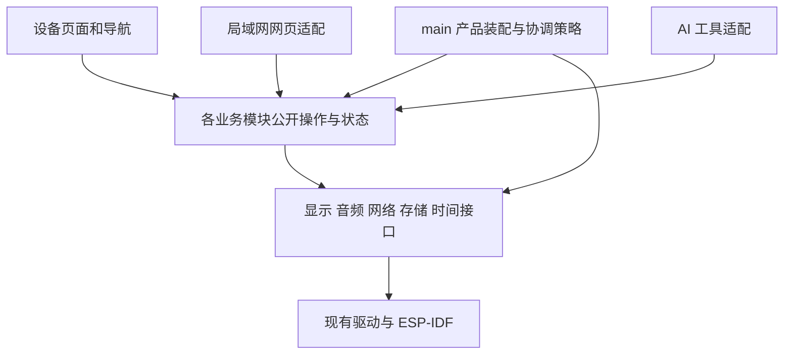

# 技术方案与边界

状态：推荐实施方案 v0.1，2026-11-10。遵守已确认产品规格；具体协议字段、内存预算、源文件拆分和上游固定版本在对应任务中落定，不能把示意设计当作现有 API。

## 1. 现有工程基线

- 当前基线为用户确认的 1.0.35 旧版产品，保留当前接线、双输出诊断、触摸和旋钮相关修复。新 UI 是在该基线上逐步替换页面，不整体替换产品树。
- 使用 ESP-IDF 6.0.1；当前公开依赖锁定 LVGL 9.5.0，见 `dependencies.lock`、`cmake/dependency-constraints.txt` 和 `main/idf_component.yml`。
- 当前有 13 个显式本地组件，见 `cmake/components.cmake`。LunarOS 是单一 IDF 组件，内部按子系统组织。
- ESP32-S3 N16R8、240×240 ST7789、SD、双 MAX98357、触摸、旋钮和双按键。引脚真源为 `sdkconfig.defaults`，不要根据变量中的 left/right 名字推断物理声道。
- 麦克风 DIN 为 GPIO21，与 GPIO47/14 对应的音频输出共享时钟。源码存在采集和小智桥接；这不等于新单轮交互及云端全流程已经验收。
- 现有基线的旧版界面、触摸、左右声道和连续旋钮操作已有用户确认；长期播放和升级负载不是因此全部通过。基线记录仍有 OTA 传输时看门狗告警观察项，保留跟踪。

### 1.1 优先核对的真实入口

| 能力 | 当前入口 | 扩展原则 |
| --- | --- | --- |
| 产品装配与调度 | `main/product/service_drivers.cpp`、`main/product/runtime_tasks.cpp` | 在现有执行器中安排有界工作，先核对任务归属 |
| 播放／曲库状态 | `main/smart_speaker/smart_speaker_runtime.h`、`runtime_internal.h` | 继续使用原所有者，不另建后台播放器或曲库副本 |
| 曲库命令与歌词 | `smart_speaker_library_commands.cpp`、`smart_speaker_lyrics_api.cpp`、`lyrics_api.h` | 扩展现有业务入口和关联规则 |
| 网页与投影 | `main/web/home.html`、`smart_speaker_projection.cpp` | 复用已有 `/api/v1/modules/smart_speaker/` 入口，避免另起一套同义 API |
| 上传 | `smart_speaker_transfer.cpp/.h` | 保留已有中断、进度和失败语义，新增资源类型需明确策略 |
| 音频及 DSP | `smart_speaker_audio.cpp/.h`、`smart_speaker_audio_lifecycle.cpp`、`smart_speaker_dsp.cpp/.h` | 保留双 I²S 生命周期、保护与诊断 |
| 小智产品桥接 | `smart_speaker_xiaozhi.cpp/.h` | 已有音频桥和音乐工具；扩展业务工具而非另建客户端 |
| Pet／Assistant | `lunaros_apps/lunaredu_pet/include/` | 保留该组件状态、行为和服务生命周期 |
| 当前产品显示 | `smart_speaker_display.cpp/.h`、`smart_speaker_character.cpp/.h` | 现有角色直绘与 LVGL 由显示任务协调，不是两条任意并发写屏路径 |
| LVGL 屏幕接口 | `lunaros/include/lunaredu_lunaros/desktop/local/lvgl_screen_runtime.h` | 沿用 surface、flush、输入与状态接口，不初始化第二套 LVGL |
| 声音焦点 | `lunaros/include/lunaredu_lunaros/app/audio_focus.h` | 已有 broker／lease；先审计产品接入情况，再补齐协调 |

表中简写的 `smart_speaker_*` 均在 `main/smart_speaker/`。后续若移动文件，应同步表格，而不是保留失效路径再创建兼容空壳。

## 2. 职责与依赖方向

箭头代表使用关系。逻辑分层不要求立刻增加同名目录、库或线程。协调策略在产品中组装能力；基础接口通过回调等方式接受产品策略，不反向链接 `main/`。

- 页面仅拥有控件、焦点、局部编辑草稿和导航状态；音乐、提醒等业务状态离开页面后继续存在。
- 每个业务状态只有一个权威写入者，公开受控命令和只读快照。事件用于通知变化，不再维护另一份可独立修改的副本。
- Pet／Assistant 保留已有所有者，音乐保留现有产品所有者。新增计时、提醒、天气逻辑先放入清晰的产品业务单元；有真实复用需求后再提炼下层组件。
- UI、HTTP、云端和传感器回调不能直接互相操作；工作提交给对应业务所有者，由其验证、执行并产生结果。
- 不创建万能 `AppManager`、万能事件总线或泛化 `shared/common` 来掩盖职责。已有注册表／队列能解决的问题不另建框架。

## 3. AmoledOS 接入

上游：[charliejgallo/ESP32S3_AmoledOS](https://github.com/charliejgallo/ESP32S3_AmoledOS)，MIT。已研究的入口包括 `components/aos_ui/aos_launcher.c`、`include/aos_app.h`、`docs/MENU.md`。

### 3.1 采用范围

一级与二级入口共用 AppLauncher 视图与原导航状态，一屏一项；二级入口使用内置 120×120 RGB565 块面图标、名称及方格分页，不显示顶部小字。AmoledOS 纵向列表保留用于宠物动作等长目录；设置详情继续使用原页面。上游分辨率为 368×448，当前产品为 240×240；重新确定字号、行高、间距、可见条目和动画幅度。

上游 UI 依赖 HAL、字体和应用模型，不能宣称复制 launcher 文件即可完成移植。P0 固定提交并列出依赖裁剪表：直接保留、轻量适配、禁用、确有必要的新接口。

不引入上游整套 OS、显示初始化、音频栈、动态应用 ABI、网络栈或 Python／WASM。保留上游版权与许可，建立修改记录。优先小范围适配，避免整仓复制后慢慢删依赖。

### 3.2 显示与输入

- 保留单一 UI 执行所有者。其他线程只提交事件或状态，不直接调用 LVGL 操作对象。
- 使用当前 `LvglScreenSurface` 和 flush 生命周期；flush 通知不阻塞、不调用 LVGL。
- 当前有串行协调的角色直绘。新角色优先评估接入 LVGL 图像；确需直绘时仍归同一显示调度，明确缓冲区所有权、覆盖恢复和 flush 时序。禁止新建独立写 LCD 的角色任务。
- 路由维护桌面、列表、二层选择和功能页面；全局对话／通知作为覆盖层管理。页面离开销毁自身资源，不停止非页面所有的业务服务。
- 先审计现有本地导航及 AmoledOS 页生命周期，只保留一套有效路由状态。兼容适配不能变成两套路由双向同步。
- 输入先转换为选择、确认、返回、主页、助手等语义，再由当前上下文消费。保留 ISR 去抖、IRAM／DRAM 安全和有界音量增量合并。
- 列表缩放／淡出优先限制在图标和局部区域，避免整行 transform 引入大离屏图层。模拟器用于视觉比较，真机用于确认输入及负载。

## 4. 统一命令与结果

沿用现有公开函数、投影和状态快照，在其边界上渐进补齐结果语义，不要求一次重写成新命令框架。

一次操作区分：参数不合法、已接收等待执行、执行成功、执行失败。异步入队不等于业务已成功。结果至少能关联请求和相关状态版本；长任务能查询进度与最终结果。

AI 工具把结构化意图转换成同一业务命令。例如“创建提醒”进入提醒所有者，不能让模型直接写存储、拼路径或调用 UI。现有音乐工具中提前返回“已播放”的做法需要结合实际执行结果检查，不能原样复制到新功能。

重复请求不能导致重复创建提醒或重复写入同一上传结果。是否采用请求 ID、幂等键或已有 revision 机制，按真实接口选定并记录。不要为简单只读查询强制建设重型消息系统。

## 5. 音频与打断协调

### 5.1 所有权

双输出、共享麦克风时钟和当前音频桥作为受控资源使用。现有 `AudioFocusBroker` 已有 lease 和代际信息，但不假设所有产品路径已完整接入；P0 核对音乐、Pet 和产品桥接的实际占用／释放路径。

产品层协调“谁希望播放”和“谁暂时占用声音”，驱动层处理 PCM 与物理生命周期。焦点切换不传 PCM，不在焦点锁中执行网络请求或无界等待。

### 5.2 恢复规则

为临时打断保存恢复凭证：原播放对象、是否正在播放、播放意图版本及打断来源。结束时只释放自己持有的有效占用；仅当意图版本未被用户或 AI 更改，且其他打断已解除时恢复。

推荐例子：音乐 → 游戏暂停音乐 → 游戏中打开助手暂停游戏输入／音效 → 关闭助手回到游戏，音乐仍保持暂停 → 退出游戏才恢复原音乐。不能用一个全局 `was_playing` 布尔值处理嵌套情形。

AI 在说话时收到“播放下一首”等命令，可以先更新业务意图，待助手释放输出后实际开始；必须准确反馈待执行／执行结果，不允许音乐和 TTS 争抢 I²S。此项为推荐协调策略，在语音切片中验证。

### 5.3 提醒与游戏

- 对话期间到点：登记待处理记录并显示非抢焦点标记；对话关闭后再弹窗并短响。
- 多条提醒推荐合并呈现列表，逐条保留记录，避免连续弹窗／铃声风暴；这是推荐呈现方式，不是删除或合并业务记录。
- 游戏中到点推荐暂停游戏输入，显示通知，提示音结束且用户关闭弹窗后继续游戏；音乐仍受游戏打断约束。
- 提示音无需独立常驻播放器；通过现有音频路径取得临时使用权。取消或失败也必须释放资源。

## 6. 助手与大肥鱼

### 6.1 助手

复用 `smart_speaker_xiaozhi` 与 Pet conversation 的音频桥、传输、Opus、工具和状态事件。2026-11-12 按用户要求改为小星使用的 LunarLink：现有 DeviceLink 提供 Board 绑定身份，bootstrap 获取 MQTT 配置，会话使用 wire v1 与 AES-GCM UDP v2、Opus20；不引入另一套 OS、播放器或 WebSocket 所有者。兼容 API 名称、迁移及远控限制见 [平台接入](07-lunarlink-platform.md)。

全局单轮是当前产品策略：左键长按或本地“你好小智”触发，自动停句，单次回答后回来源页并恢复本地唤醒检测，不自动连续云端聆听。所有页面共用 Pet 的会话状态和音频生命周期；产品输入只调用明确的 request/cancel 接口。后台 MQTT 连接与前台对话占用区分，重连不能锁住页面。

取消与重新聆听由 Pet 队列优先处理；请求先使旧代际失效，音频迭代在运行锁外停止，再清空排队音频、停旧输入／回答并更新状态。回答中重新聆听保留服务端会话身份与焦点；失败则释放焦点。字幕、TTS 与下行音频校验当前阶段／会话／代际，防止旧结果重开输出。协议未携带 turn id 的迟到消息仍需真机时序验收，不能用主机代际检查代替服务端联调。

资源种子从已有公开 ESP-SR 组件选取 `wn9s_nihaoxiaozhi`，打包为现有 managed-assets 的 `model` 记录（长度、SHA-256、版本与原许可证），沿用 LittleFS 分区，不新增模型分区。已有设备应经安装接口补装单项模型，不能重刷文件系统覆盖用户配置。待机 RX 与音乐 TX 共用 I²S0，启用采集不能静音或改音乐时钟；输入边界以有界流式面积平均将当前 8–48 kHz 总线数据转换为 16 kHz。DMA 分块保留分数相位，采样率／启停代际变化使旧缓存失效；重配后仅按当前采集意图恢复 RX。语音输出结束后恢复播放器最新请求的采样率，空闲的重复关闭输出不静音音乐。缓冲由现有 Pet 音频工作线程唯一消费，不新增采集任务或 I²S 所有者。

全局待机唤醒的 CPU、内存、音乐串音和识别率纳入联合负载验收。

端点／鉴权通过已有设置与存储边界管理，检查能否原生支持配置；确有缺口才补适配。凭据不进入源码、日志、诊断快照、测试夹具或文档。常规状态回显只提供脱敏信息。

### 6.2 大肥鱼资源

2026-11-11 更新：用户指定 `PC2005-cloud/dsh-pet` 形象并要求保存全部动画。固定提交 `c25386848f70f6e40902e4376f6e7b1e196bc326` 的 114 个 WebM 和 109 个 GIF 已原样归档。114 段 SD 动画已接入同一存储和显示所有者，V2 每个读盘分段最多 12 帧；无可用动画时使用下文 legacy 路径。设备包、触摸边界和验收见 [角色方案](06-pet-character.md)。新版形象授权以直接来源 README 的 CC BY-NC-SA 4.0 为准。

用户确认采用 legacy 大肥鱼帧并声明持有该素材的再分发授权。来源固定为 [QCYTSN/dsh-dafeiyu](https://github.com/QCYTSN/dsh-dafeiyu) commit `084323845ab82b68d5388d5c638bec09d8544a8a`；上游 `ASSET_LICENSE.md` 明确 legacy 帧不属于代码 MIT 许可，因此项目记录保留上游声明，不把用户授权扩写成上游通用许可。当前导入的 49 张运行帧逐一固定 Git blob SHA-1、大小和 SHA-256；四张 `dragging/` 是单独社区贡献，当前按授权范围未分别确认为止先排除。

离线工具为 19 张选定 idle／情绪／思考／说话／互动帧生成居中 160×160 PNG 和黑底小端 RGB565，资源部署于 SD `/characters/dafeiyu/<clip>/<frame>.rgb565`。转换清单逐帧记录源／目标 SHA-256；runtime 由网络／存储所有者读取单帧到有界 PSRAM 缓冲，显示任务只持有不可变快照并复用 RGB565 分块渲染。素材加载失败保留明确错误和既有角色回退。

网页按固定 19 帧白名单校验所选 staging 目录，再通过现有 network-I/O executor 的 `pet.frame.upload` bulk API 逐帧上传。每帧采用 `.upload` 临时文件、固定字节数校验和 rename 发布；中断不替换现有完整帧，可通过重选目录重传。该路径尚未经过 Mac／Windows 浏览器或真机断网／写失败实测。

当前映射使用大肥鱼现有静态情绪帧和 poke 序列；同一状态去重、完整状态／短互动优先级、语音强度视觉反馈、重复状态恢复、资源热插入重试仍需继续完善。真机解码、帧时延、音乐 SD 并发与内存预算未验证，不能据代码接入宣称 A-PET 通过。

角色表现读取规范化的会话状态与情绪，不直接解析特定云服务 JSON。相同状态事件不反复重启动画；短互动结束回到最新状态。动画加载失败时显示明确的静态回退，不能影响语音结束和资源释放。

## 7. 时间、提醒与持久化

- 时钟可信度显式区分“未校准／可信／需重新确认”。没有经过检查，不宣称设备有断电保持的 RTC。
- 计时持续时间使用单调时钟；具体日期提醒使用时区明确的墙上时间。NTP 校时、手动改时、时区变化不能触发同一提醒多次。
- 启动时先加载持久数据，获得可信时间后判定错过事件，不在未知日期下响铃。重复提醒根据规则计算下一次，错过记录与规则分开保存。
- 番茄钟保存轮次、阶段、剩余时长及必要版本，重启暂停等待继续。周期性保存应兼顾磨损和掉电恢复精度，在 P4 明确保存点及误差。
- 配置优先复用 NVS；音乐、封面、歌词、壁纸、动画存 SD。提醒和番茄钟持久记录的存储介质在 P0／P4 核对现有接口、容量和缺卡需求后确定，不擅自假设所有数据都能塞入 NVS。
- 用户记录有 schema 版本与失败恢复方法。批量资源采用临时写入／验证／提交，失败不替换原可用资源；不为支持迁移自动清空 NVS 或格式化 SD。

## 8. 网页和天气

### 8.1 网页及上传

复用现有设备网页和投影入口。命令经业务所有者执行，状态来自设备快照。先复用现有状态获取机制；只有实测必要时再引入推送，不同时建设轮询、SSE、WebSocket 三套状态源。

上传流式分块，有界缓冲；校验资源类型、大小、路径和剩余空间；取消／失败清理临时资源。上传、解码、曲库扫描不在 UI 或音频回调中阻塞执行。若并发上传会危及播放，明确限流或忙碌结果，不能悄悄抢占声音。传输完成与索引生效分别反馈。

局域网是部署范围，不等于自动信任任意请求。沿用可复用的访问控制，P0 明确网页敏感配置的访问边界及凭据回显方式；不为首发另建云账号系统。

### 8.2 天气

天气由单一业务单元周期更新，页面只读缓存。标注地点、更新时间和过期／失败状态；断网可显示明确标注的上次结果。选择天气 API 时核对地域、密钥与使用条件，不编造免费额度和可用性，不把浏览器端暴露密钥当作默认方案。

## 9. 资源与退化

网络、SD、动画转换／解码、UI 和音频工作有明确预算及队列上限。优先使用现有执行器；只有阻塞性质或实时性要求有证据支持时才增加线程，记录栈、优先级、退出及唤醒方式。

资源紧张时推荐先降低动画刷新、延后低频天气更新或限制后台上传，保持输入可响应和音频连续。不得靠提高所有任务优先级、关闭看门狗、无限增大缓存或隐藏错误解决争用。

P0 定义测量方法，P1／P3 用真机形成明确预算：可用 DMA SRAM／最大连续块、PSRAM、刷新耗时、输入延迟、音频最大写间隔、SD 并发和网络重连。原始素材 24fps 不是最终产品帧率承诺。

## 环境声实现边界（2026-11-12）

Runtime 的 ambient::Session 唯一持有场景、首次选择、浮层及定时；原命令队列负责播放/定时执行，
原音频焦点的代际和意图恢复保持有效。定时从 runtime tick 推进，早于助手恢复，
到期先撤销恢复意图，再在语音/游戏释放硬件后停止已暂停的解码器；不在显示刷新中计时。
smart_speaker_ambient 提供从 SD 规范 WAV 连续循环读取的可 seek FILE，交给原 WAV 解码器关闭，
不新增任务、I²S 或播放器。末 5 秒衰减仅发生在该源 PCM，不影响语音和系统音量。
默认图片 RGB565 放 Flash；自选图片复用 desktop_resources I/O 锁、BMP 验证和不可变 PSRAM 快照，
按场景关联存 LittleFS、最后成功场景存原播放器 NVS 命名空间。定时不跨重启恢复。
上传沿用 projection 的流式上传契约和 player operation 锁；资源校验及 FAT 备份发布通过后返回 stored，
播放/定时命令仅返回 queued，实际效果从状态读取。未安装资源保持可见错误，不回退到合成噪声。
