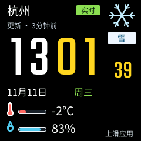
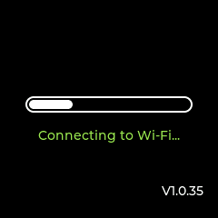
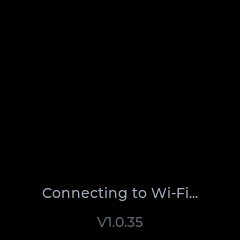

# 首发上游来源记录

状态：来源及移植记录，2026-11-11。1.0.35 基线与显示所有者保留；AmoledOS 的必要纵向列表代码已在产品显示层适配编译。

| 来源 | 计划用途 | 当前证据 | 交付边界 |
| --- | --- | --- | --- |
| [ESP32S3_AmoledOS](https://github.com/charliejgallo/ESP32S3_AmoledOS) | 纵向图标＋文字列表、二层导航的交互参考 | 技术方案记录了 launcher、`aos_app.h` 和菜单文档；已核验固定提交 `3e8a3deead60cf86b5994a770007ff3247b8fdf9`，launcher 和 LICENSE 保存在 `components/lunaredu_character_assets/third_party/amoledos/` | P1 接入前须核对提交、MIT 许可、字体与 HAL 依赖；本仓库继续沿用现有 LVGL 所有者 |
| [dsh-dafeiyu](https://github.com/QCYTSN/dsh-dafeiyu) | 用户选择的大肥鱼宠物 | 2026-11-11 固定提交 `084323845ab82b68d5388d5c638bec09d8544a8a`；用户确认持有 legacy 大肥鱼素材再分发授权。49 张运行帧按 Git blob SHA-1、大小、SHA-256 固定；保留上游 `ASSET_LICENSE.md`，不将用户授权表述为 MIT 或上游通用授权 | 转换工具、资源 staging、SD 帧读取已接入；四张独立社区 dragging 帧未单独确认授权范围而排除。真机运行与性能验收未完成 |
| [dsh-pet](https://github.com/PC2005-cloud/dsh-pet) | 用户指定的新版动态角色与桌宠互动参考 | 固定提交 `c25386848f70f6e40902e4376f6e7b1e196bc326`；[原始归档](../../components/lunaredu_character_assets/third_party/dsh-pet/README.md) 含全部 114 个 WebM、109 个 GIF 和交互参考 | 代码 MIT；直接来源 README 标明角色 CC BY-NC-SA 4.0。原件已核验，设备派生与播放待实现 |

当前产品实现的导航、时间和游戏状态在 `main/product/product_state.*`，没有引入上游 OS、第二套显示初始化、动态应用 ABI 或第二套播放器。早期记录中的“等待用户选择当前形象／排除 legacy”已被用户明确选择和授权更新。

### 白噪声音频切片（2026-11-11）

白噪声通过锁定的 `chmorgan/esp-audio-player` WAV 解码路径播放。产品侧提供可 seek 的确定性 PCM 源（固定 22.05 kHz、16-bit stereo、受限振幅），不创建第二播放器或第二 I²S 所有者；源由 `funopen` 在解码任务中按块生成，结束时由播放器关闭。该切片启用 `CONFIG_AUDIO_PLAYER_ENABLE_WAV`，继续复用现有 EQ、音量、限幅和双输出保护链。音频循环由既有播放代际和完成队列控制，暂停、停止、音乐切换及助手焦点均沿用同一状态。

### AmoledOS 列表适配（2026-11-11）

`main/smart_speaker/smart_speaker_amoled_list.cpp` 直接改编固定提交 launcher 的 `setup_list`、`add_list`、`list_scroll_cb` 与 `apply_falloff`。保留纵向 flex、图标与文字行、仅对子对象且仅在变化时写入的边缘透明度；改为 216×160 可视区域、48px 行高和最多七项，避免完整行 transform/opacity 形成离屏合成层。一级和二层页共用该视图，单一 `ProductState::Navigation` 仍持有页与焦点，旋钮/触摸手势仍经现有产品输入路由，显示任务负责滚动至焦点。未接入上游 grid/honeycomb、HAL、应用注册、动态文件夹状态或第二输入设备。

本地适配文件保留上游版权和 SPDX MIT，完整许可保存在第三方目录。原始 launcher 作为比对源保留。当前改编完成源码/构建验证后仍需 240×240 真机截图、输入响应和内存/音频联合负载证据，不能引用上游手表测试作为本硬件结果。

### 大肥鱼素材授权核验（2026-11-11）

下两段保留早期核验时的来源与条件。用户后续明确选择直接来源 `dsh-pet` 并要求全量归档；新版角色授权以该来源的原始 README 为准，不采用间接项目对素材 MIT 的转述。legacy 另按已有授权范围保留，当前运行时未切换。

只读核对 GitHub 固定提交 `084323845ab82b68d5388d5c638bec09d8544a8a`（0.1.23）的仓库元数据、树和 `ASSET_LICENSE.md` / `README.md`。当前 `assets/pet/` 来自 `PC2005-cloud/dsh-pet`，其 MIT 许可明确覆盖这些角色资源；后续导入只允许这一目录并保留 `assets/dsh-pet-LICENSE.txt` 和资源来源清单。原始源片段固定为 `549fff2ea33c2acfb16612c76912c6137da4a758`，由上游 `assets/pet-manifest.json` 记录源 SHA-256、取帧范围和裁切参数。

仓库当前 manifest 的 characterId 是 `whaletail-maid`；已请用户核对这是否为其指定的当前形象。等待素材外观回复期间可继续非素材工作，不回退到受限的 `legacy/dafeiyu/`。后者仅供该 companion plugin 使用，未获外部再分发许可。透明 WebP 为 412×344、24fps；需离线转换、记录源与输出 hash、定义动作映射，并在目标硬件测 SD／内存／刷新预算后才可完成 A-PET。

### 歌曲封面准备（2026-11-11）

封面与静态壁纸共用离线 BMP24 规范（240×240、中心裁切），由 `tools/resource-tools/prepare_cover.py` 调用已锁定 Pillow 11.3.0 的转换函数；没有新增依赖。该工具只规范图像格式，不修改来源文件或写设备 SD。

### 信息首页与数字字体（2026-11-11）

首页按用户提供的 [GeekMagic SmallTV](https://github.com/GeekMagicClock/smalltv) 天气时钟截图适配：上方地点／状态／天气，大号白色小时、黄色分钟及秒数，下方日期／星期与温湿度，右下留给用户自备背景。官方仓库提供固件与说明书，未提供可移植的 UI 源码；不将“视觉参考”表述为“复用了其开源 UI”，也未导入其二进制、图片或字体。`smart_speaker_home.cpp` 是产品原生 LVGL 实现；应用列表仍直接改编前述 AmoledOS launcher，没有替换 1.0.35 OS／显示／路由所有者。

窄体数字使用 [Google Fonts Teko](https://github.com/google/fonts/tree/8b0a1d0f5983c89bc2b93f1b5fb55f9e252744b5/ofl/teko)，固定提交 `8b0a1d0f5983c89bc2b93f1b5fb55f9e252744b5`，OFL 1.1。原字体 SHA-256 `d1321889f262bbbff632e7976349853399cd097b6f382d4b19790c915c13c1ae`；原件、许可证及逐文件摘要保存在 `components/lunaredu_character_assets/third_party/teko/`。现有中文字体不变。Teko 提供参考图所需窄体大数字，无需放大整层或引入另一字体渲染器。

离线生成器 `tools/resource-tools/prepare_clock_font.py`（FontTools 4.60.1）固定 weight 400，子集 `0123456789:-`，等宽居中数字、收紧行框并改名为 Speaker Home Digits，保留版权／许可记录。2,472-byte 子集 `main/assets/home_digits.ttf`（SHA-256 `b0e04f6d8471aca2528da0a222583b08bdb4cdd98b8887a5fc6086d069c9a969`）用于离线生成与主机对照。`tools/ui-preview/export_clock_font.cpp` 用锁定的 LVGL 9.5.0 TinyTTF 生成 100／42 px 的 A8 掩码与字距，固件使用 `main/assets/home_clock_font.c` 的只读位图（SHA-256 `360ba73ef7b2386fc913a9c2055b52649d5ebeb24412df82f65847b5653f6e68`）。两个字号均与此前的 TinyTTF 逐像素对照；数字显示不需要在设备上重新栅格化或保留两份 TinyTTF 缓存。共用中文字体不变。

实际 LVGL 主机预览与复现命令见 `tools/ui-preview/README.md`。下图使用雪天气、13:01:39、-2°C／83% 的显式测试夹具，黑底且未加载用户背景；不是当前设备数据或真机截图。

### 开机动画视觉参考（2026-11-11）

开机动画另按用户提供的 SmallTV 加载画面照片实现：黑底、白色胶囊活动条、绿色连接状态和右下版本。`smart_speaker_boot.*` 是原生 LVGL 产品代码，复用 LVGL 自带 Montserrat 14；未引入 SmallTV 素材、二进制或源码，也没有新增运行库依赖。动画由已有显示循环驱动并释放，只读取网络状态，不改变网络／音频／启动健康检查所有者。主机 GIF 见下图，其联网时序及首页数据均为测试夹具。

后续根据用户反馈增加加载完成到信息首页的连续转场：前景条／文字用 120 ms 淡出，黑色背景以 smoothstep 曲线在 420 ms 内揭开首页；显示任务在遮罩仍不透明时准备首页。只修改对象的背景、边框和文字绘制透明度，不对整个父对象设置 `opa`，避免额外整屏合成层。Pet 直接绘屏在遮罩释放后恢复。下图为更新后的主机夹具，不是实屏录像。

### 开机动画重新选型：源码与视觉研究（2026-11-11）

用户认为加载条及随后增加的淡出仍不够优雅；前述实现和 GIF 保留为历史，不代表视觉方案已获认可。本轮只核验以下参考，未引入其源码／素材或烧录新方案。

| 参考 | 核验事实 | 对本产品的用途与边界 |
| --- | --- | --- |
| [LVGL Music Demo](https://lvgl.io/demos/music/index.html) | 已查看官方网页开场和播放器画面；当前锁定 LVGL 9.5.0 的 `demos/music/lv_demo_music_main.c` 包含标志缩小退场、频谱条错峰展开、封面缩放和内容分段入场，许可 MIT | 可在现有显示所有者内参考其时间线和缓动。官方网页部署版本未单独固定，具体代码以本地锁定的 9.5.0 为准；不导入整个播放器 |
| [X-TRACK StartUpView.cpp](https://github.com/FASTSHIFT/X-TRACK/blob/c42b8e5605e50838f4c0c9828385948fa33ab485/Software/X-Track/USER/App/Pages/StartUp/StartUpView.cpp) | 固定提交 `c42b8e5605e50838f4c0c9828385948fa33ab485`；已读实际视图源码：110×50 容器，橙色底边，宽度从 0 展开 500 ms，之后标题从下方移入 500 ms，ease-out。README 核实为 240×240 ST7789、LVGL 8，MIT | 小屏简洁开场参考；LVGL 8 接口不能直接原样移入当前 9.5.0。尚未核验其开场到地图页的完整退场，不以视图源码推断已有连续变形转场 |
| [adi1090x/plymouth-themes](https://github.com/adi1090x/plymouth-themes#previews) | 仓库说明包含 80+ Android 开机动画移植主题，仓库 GPL-3.0；实际打开 Pack 1 的 [Circle Flow 动图](https://raw.githubusercontent.com/adi1090x/files/master/plymouth-themes/previews/10.gif)，观察黑底多层彩色圆弧 | 仅作视觉风格参考；Plymouth 运行环境不适用于 ESP32，不直接搬入序列帧或据仓库许可证推定每个品牌图案的独立权利 |

推荐方向（设计提案，尚未实现或得到用户确认）：借鉴 X-TRACK 的留白和有限强调色，结合 Music Demo 的连续编排。中央短线／标记出现后形成时钟视觉元素；就绪时同一元素移动到首页位置，再让日期、天气与背景分段入场。需要通过生产 LVGL 主机动画验证元素的连续性，再做实体屏幕节奏和刷新负载验收。此提案是本产品的适配设计，不能称为上游已有的“标记变时钟”效果。

### 连续时钟开场实现（2026-11-11）

用户要求实现上述方向后，`smart_speaker_boot.*` 以原生 LVGL 重写开场编排：黄色细线展开，`SpeakerHome` 原有小时／分钟通过透明容器裁切显露，在网络就绪或有限等待结束后平移至首页；秒数、日期、天气与温湿度按时间线分段显露，最后以带柔边的向下揭示带出既有壁纸，局部刷新新露出的区域。线和状态／版本由开场视图临时持有，退出删除；首页五个裁切容器随常驻视图持有，退出／取消统一恢复其位置和尺寸。沿用既有显示循环，无新任务／计时器、整屏截图、alpha 合成层或第二份时钟／业务状态。未校时仍显示 `--`；已存 Pet／配网路径使用有界遮罩回退，直接绘屏在开场退出后恢复。

这是参考两项目编排原则的独立产品实现，**没有复制 X-TRACK／Music Demo 的源码、标志、字体或图像**，未新增公开组件依赖、修改 SDK 或 LVGL 锁版本。X-TRACK 的 LVGL 8 接口未混入当前 LVGL 9.5.0。前述“设计提案尚未实现”的状态以本段更新；真机视觉仍需单独验收。

下图为生产 LVGL 240×240 RGB565、40 ms 步长的主机夹具（杭州、13:01:39、24°C、57%、联网 1.6 秒／校时 2.4 秒），不是设备录像。完整首页与改动前主机渲染逐像素一致；中途取消也恢复为完整首页。无背景素材时按产品规则使用黑底。

### Open-Meteo 天气服务（2026-11-11）

只读核对公开 `/v1/forecast` 端点的 `current` 字段：`temperature_2m`（°C）、`relative_humidity_2m`（%）、`weather_code`（WMO code）和 `time`（unixtime）。服务条款允许个人非商业使用，免费 API 受每 IP 10,000 次／日、5,000 次／小时、600 次／分钟限制，并要求 CC-BY 4.0。固件固定 HTTPS 公开端点，不发送凭据；地点由用户输入经纬度，保存来源、数据年龄和离线/过期状态。商业发布前必须重新核对服务条款或替换有授权的服务。

## 电子木鱼交互参考（2026-11-12）

参考 `IvanHanloth/wooden-fish` 的 `main.js`、`index.css` 中点击缩放回弹和上浮计数的交互，以及 `Ares-Chang/wooden-fish` 的输入反馈。两仓库首页标注 MIT；本次未复制其源码、SVG 或音频。最终浅色剪影依据用户提供的界面参考重新绘制于 `main/assets/wood_fish.svg`；此前试画及生成的立体木鱼均未采用。音效为本工程原创的有限时长模态合成，无外部音频素材或新固件依赖。

## 音乐唱片页参考（2026-11-12）

- 用户选定圆形旋转封面、细密环形频谱、顶部歌名、单句歌词及黑／暖黄配色。视觉参考为本工程锁定 LVGL 9.5.0 的 `demos/music/`（MIT）；其官方演示使用预生成频谱，本产品改用当前歌曲 PCM 的实时分析。
- 动态规则参考 CAVA 的对数频段、平滑与回落理念（https://github.com/karlstav/cava/blob/master/CAVACORE.md），未复制其代码或链接 FFTW。项目内独立实现 Hann 窗、1024 点 FFT、16 个对数频带与 64 条镜像环形短线，无新增第三方依赖或演示音乐／封面素材。
- 默认黑胶为产品代码生成的几何纹理；主机预览的渐变封面与合成 PCM 仅作显式测试夹具，不进入固件。

### MP3 内嵌封面与歌词提取

网页端独立实现有界 ID3v2.3／2.4 APIC、USLT 读取，格式依据 [ID3v2.3](https://id3.org/id3v2.3.0)、[ID3v2.4 结构](https://id3.org/id3v2.4.0-structure) 与 [帧定义](https://id3.org/id3v2.4.0-frames)。没有引入解析库或复制第三方实现。封面继续使用原浏览器 Canvas → 240×240 BMP 和设备封面存储；歌词继续使用原 UTF-8 LRC 接口。不支持的标签明确提示。
